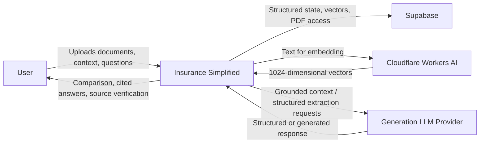

# ARCHITECTURE — Insurance Simplified

| Status | Version | Owner |
| --- | --- | --- |
| LOCKED V1 | V1 | Akhil |

---

## 1. Purpose

This file defines the locked V1 architecture for Insurance Simplified.

It answers:

- what components exist;
- why each component exists;
- what responsibility each component owns;
- where each kind of state lives;
- how components communicate;
- what is allowed to remain temporary;
- what must survive process restarts;
- what AI coding tools are not allowed to redesign silently.

The governing rule is:

> Requirement creates responsibility.  
> Responsibility creates component.  
> Component creates technology choice.

---

# 2. System at a Glance

```text
                         USER BROWSER
                              │
                              │ HTTPS
                              ▼
                  ┌────────────────────────┐
                  │   GOOGLE CLOUD RUN     │
                  │                        │
                  │ Next.js application   │
                  │ UI + API + services   │
                  │ deterministic rules   │
                  │ RAG orchestration     │
                  └───────┬───────┬────────┘
                          │       │
                    ┌─────┘       └───────────────┐
                    │                             │
                    ▼                             ▼
       ┌────────────────────────┐      ┌────────────────────────┐
       │       SUPABASE         │      │ CLOUDFLARE WORKERS AI  │
       │                        │      │                        │
       │ PostgreSQL             │      │ Embedding inference    │
       │ pgvector               │      │ Qwen3 Embedding 0.6B   │
       │ Private Storage        │      │ 1024-dimensional       │
       └────────────────────────┘      └────────────────────────┘
                    │
                    │
                    │                             ┌─────────────────────┐
                    └────────────────────────────►│ GENERATION LLM      │
                                                  │ PROVIDER            │
                                                  │                     │
                                                  │ extraction /        │
                                                  │ grounded language   │
                                                  └─────────────────────┘
```

OpenCode, Claude Code, Gemini coding tools, and other development models are not
runtime components in this diagram.

They help build the application.

They are not automatically dependencies of the application.

---

# 3. Context Diagram



---

# 4. Deployment Topology

Production application compute runs as a stateless container on Google Cloud Run.

```text
Browser
   │
   ▼
Cloud Run
   │
   ├── Supabase PostgreSQL / pgvector
   ├── Supabase Private Storage
   ├── Cloudflare Workers AI
   └── Generation LLM Provider
```

Cloud Run instances are replaceable.

Therefore:

```text
anything needed only during one request
→ may use local memory / temporary filesystem

anything needed by a future request
→ must be durable outside the Cloud Run instance
```

The local filesystem is never authoritative cross-request state.

---

# 5. Component Responsibilities

## 5.1 Browser

### Responsibility

Provide the user-facing Insurance Simplified experience.

It owns only temporary interface state.

### Handles

- Welcome page;
- Intake page;
- Results Workspace;
- plan/tier selection;
- section navigation;
- contextual missing-information input;
- chat interface;
- evidence viewer interaction.

### Owns Durable State

None.

The browser must not be treated as the source of truth for:

- uploaded documents;
- extracted facts;
- evidence;
- comparison state;
- authorization;
- citations.

---

# 5.2 Cloud Run Application

### Technology

Google Cloud Run running the project's Dockerized Next.js application.

### Responsibility

Own application behavior and orchestrate all product operations.

### Contains

Logical responsibilities inside the same deployable application:

```text
UI routes
API routes
upload authorization
document processing
PDF extraction
chunking
comparison extraction
deterministic rules
retrieval
citation verification
chat orchestration
session lifecycle
deletion orchestration
health / readiness
```

These responsibilities are modules inside one application.

They are not separate infrastructure services in V1.

### Owns Durable State

None directly.

Durable state belongs in Supabase.

---

# 5.3 Supabase PostgreSQL

### Responsibility

Authoritative structured state for the application.

### Stores

Examples include:

```text
sessions / ownership scope
documents and metadata
user context
pages
chunks
plan / tier metadata where required
evidence metadata
comparison-derived structured state
document processing state
deletion state
```

Exact tables and constraints are defined in `DATA_MODEL.md`.

### Source-of-Truth Rule

For structured application state:

```text
PostgreSQL = source of truth
```

Cloud Run memory is not the source of truth.

---

# 5.4 Supabase Storage

### Responsibility

Store original uploaded PDF bytes durably and privately.

### Source-of-Truth Rule

For original document bytes:

```text
Supabase Storage = source of truth
```

PostgreSQL stores metadata and the object key.

The database should not contain the PDF binary itself.

---

# 5.5 pgvector

### Responsibility

Provide semantic similarity search over document chunks.

### Important Distinction

pgvector is a derived retrieval index.

It is not the source of truth for document content.

Conceptually:

```text
Original PDF
    ↓
Page text
    ↓
Chunks
    ↓
Embeddings
    ↓
pgvector
```

If the semantic index were lost, it should be possible to rebuild it from the
durable source data.

---

# 5.6 Cloudflare Workers AI

### Responsibility

Convert text into embedding vectors for production.

Production model:

```text
Qwen3 Embedding 0.6B
```

Expected embedding dimension:

```text
1024
```

Conceptually:

```text
text
  ↓
Cloudflare Workers AI
  ↓
1024-dimensional vector
```

### Owns State

None.

Cloudflare does not own:

- PDFs;
- sessions;
- comparison state;
- stored vectors;
- citations.

It performs embedding inference only.

---

# 5.7 Generation LLM Provider

### Responsibility

Perform language-model tasks inside explicitly defined product boundaries.

May be used for tasks such as:

- structured information extraction;
- explanation;
- grounded question answering.

### Does Not Own

- authorization;
- user/session ownership;
- document truth;
- citation validity;
- deterministic numeric calculations;
- deterministic eligibility rules;
- product requirements.

The provider is behind an adapter boundary so the application is not coupled to
one model vendor unnecessarily.

---

# 5.8 Deterministic Rule Layer

### Location

Inside the Cloud Run application.

### Responsibility

Handle decisions that must not depend solely on free-form LLM reasoning.

Examples:

```text
context requirements
eligibility rules
requirement checks
numeric comparisons
evidence-state decisions
citation verification
conflict rules
material-token checks
```

### Important Rule

AI may explain the result.

AI is not the sole authority for deterministic product truth.

---

# 6. Document Upload Flow

PDF upload should avoid unnecessarily sending large document bytes through the
application container.

Target flow:

```text
Browser
   │
   │ 1. Request permission to upload
   ▼
Cloud Run
   │
   │ 2. Validate session / file intent
   │ 3. Create narrowly scoped upload permission
   ▼
Browser
   │
   │ 4. Upload PDF bytes directly
   ▼
Private Supabase Storage
   │
   │ 5. Durable object exists
   ▼
Cloud Run
   │
   │ 6. Register/process object
   ▼
PostgreSQL
```

The application still controls whether an uploaded object is accepted into a
comparison session.

Direct upload does not bypass product validation or ownership rules.

---

# 7. Document Processing Flow

After the user chooses `Compare my plans`:

```text
Cloud Run
   │
   ├── load durable document metadata
   ├── read PDF from private storage
   ├── extract page text
   ├── preserve page provenance
   ├── identify plan/tier structure
   ├── extract comparison facts
   ├── create deterministic page-bounded chunks
   │
   ├── send chunk text to Cloudflare Workers AI
   │       ↓
   │   receive 1024-dimensional embeddings
   │
   ├── persist pages / chunks / vectors
   ├── apply deterministic comparison rules
   ├── register evidence
   └── mark session READY / PARTIAL / FAILED
```

Processing may temporarily use Cloud Run's local filesystem.

Temporary files must not become the only copy required by future requests.

---

# 8. Retrieval and Chat Flow

When the user asks a question:

```text
Browser
   │
   │ question + session
   ▼
Cloud Run
   │
   ├── validate session scope
   │
   ├── embed question
   │       ↓
   │   Cloudflare Workers AI
   │
   ├── query scoped pgvector retrieval
   │       ↓
   │   relevant chunks
   │
   ├── enforce usefulness / grounding rules
   │
   ├── if insufficient evidence
   │       ↓
   │     refuse / uncertainty
   │
   └── if sufficient evidence
           ↓
       Generation LLM
           ↓
       grounded answer
           ↓
       citation verification
           ↓
       Browser
```

Authorization / ownership filtering happens before evidence is supplied to the
generation model.

---

# 9. Evidence Verification Flow

The existing evidence contract remains a protected part of the architecture.

Conceptually:

```text
comparison value / chat answer
          ↓
       citation
          ↓
    evidence record
          ↓
original PDF + page
          ↓
 PDF Evidence Viewer
```

A displayed citation must correspond to evidence that can be verified against
the original document and page.

The evidence viewer is not replaced by generated summaries.

---

# 10. User Context Update Flow

The initial Intake page collects core context.

If processing later discovers that another specific value is required:

```text
Comparison
    ↓
NEEDS YOUR INPUT
    ↓
User supplies missing context
    ↓
Persist context update
    ↓
Recompute affected deterministic result
    ↓
Return to same Results Workspace
```

The user does not:

- create a new session;
- re-upload documents;
- restart the comparison.

---

# 11. No-Document Path

The no-document path remains inside the application.

```text
User Context
      ↓
Cloud Run application
      ↓
deterministic / defined checklist logic
      ↓
Requirements Checklist
```

It does not perform market-wide plan discovery.

It does not require:

- insurer crawling;
- plan catalog;
- search index;
- scheduled ingestion system.

---

# 12. State Ownership

| State | Owner |
| --- | --- |
| Original PDF bytes | Supabase Storage |
| Document metadata | PostgreSQL |
| User context | PostgreSQL |
| Processing state | PostgreSQL |
| Page text | PostgreSQL |
| Chunk text / metadata | PostgreSQL |
| Embedding vectors | PostgreSQL / pgvector |
| Evidence metadata | PostgreSQL |
| Session ownership scope | PostgreSQL |
| UI selection such as active tab | Browser unless persistence is required |
| Temporary processing files | Cloud Run ephemeral storage |
| Embedding model state | Cloudflare managed service |
| LLM model state | Generation provider |

Every durable piece of product state has exactly one authoritative owner.

---

# 13. V1 Isolation Model

V1 does not require end-user account creation.

The runtime uses an anonymous comparison-session boundary.

Every retrieval and document operation must be scoped to the active session.

Conceptually:

```text
request
   ↓
session scope
   ↓
authorized documents/chunks only
   ↓
retrieval
   ↓
model
```

Never:

```text
global retrieval
   ↓
model
   ↓
filter answer afterward
```

Database RLS may provide additional enforcement where authenticated database
identity exists, but V1 must not falsely claim that anonymous runtime sessions
are equivalent to a complete end-user authentication system.

---

# 14. Environment Boundaries

## Local Development

May use:

```text
local Next.js / Docker
Supabase development project
local Ollama embedding provider where useful
configured development generation provider
```

## Production

Target:

```text
Google Cloud Run
Supabase PostgreSQL
Supabase pgvector
Supabase private Storage
Cloudflare Workers AI embeddings
configured generation LLM provider
```

The embedding implementation remains behind the same application adapter
boundary.

Development and production may use different embedding compute providers while
preserving the same vector contract.

---

# 15. Secret Boundary

Local development secrets may exist in:

```text
.env.local
```

`.env.local` is never committed.

The repository contains only safe variable names/placeholders in:

```text
.env.example
```

Production secrets are injected through Google Cloud's production runtime secret
configuration.

Secrets must never be:

- baked into the Docker image;
- committed to Git;
- sent to the browser;
- printed in logs.

---

# 16. V1 Non-Components

The following are intentionally not part of the V1 production architecture:

```text
Redis
Kafka
separate message queue
background worker service
Kubernetes
Pinecone
Qdrant
a second application database
production Ollama
Starkwolf / Hetzner deployment
market-wide plan crawler
plan catalog
separate microservices
```

They may only be introduced later if a measured requirement creates a
responsibility that the current architecture cannot satisfy.

---

# 17. Queue / Worker Decision

The worked Insurance Simplified example in the architecture playbook includes a
queue and worker.

V1 intentionally does not copy those components automatically.

Current architecture:

```text
Cloud Run application
        ↓
synchronous / request-orchestrated processing
```

A queue or separate worker earns a place only if measured behavior demonstrates
a requirement such as:

- processing cannot reliably finish within the chosen execution model;
- work must survive independently of the initiating request;
- automatic retry requires durable asynchronous ownership;
- measured load requires decoupled processing.

Until one of those requirements exists:

```text
NO QUEUE
NO SEPARATE WORKER
```

---

# 18. Deployment Principle

Cloud Run application instances must be disposable.

A container may disappear without destroying:

- PDFs;
- session state;
- pages;
- chunks;
- vectors;
- evidence;
- comparison state required by future requests.

Therefore the production application is designed as stateless compute over
durable external state.

---

# 19. Cost Constraint

The V1 flagship is intended for portfolio/demo-scale usage within approved
free-tier or zero-new-spend constraints.

No AI coding tool may introduce a paid dependency because it appears convenient.

Cloud services must be configured and reviewed against the project's cost
constraint before production deployment.

---

# 20. Architecture Change Rule

This architecture is human-owned.

If an implementation proposal:

```text
adds a component
removes a component
changes state ownership
introduces another persistence store
changes the authentication model
changes the deployment topology
moves synchronous work to asynchronous infrastructure
introduces a load-bearing external dependency
```

then it is an architecture change.

OpenCode must stop and request explicit approval.

Implementation tools may freely make local implementation decisions inside the
approved component boundaries.

---

# 21. Final V1 Component Set

```text
User Browser
       │
       ▼
Google Cloud Run
Next.js Application
       │
       ├──────────────► Supabase PostgreSQL
       │                       +
       │                    pgvector
       │
       ├──────────────► Supabase Private Storage
       │
       ├──────────────► Cloudflare Workers AI
       │                 Embeddings
       │
       └──────────────► Generation LLM Provider
```

No additional runtime component is required for the approved V1 architecture.
